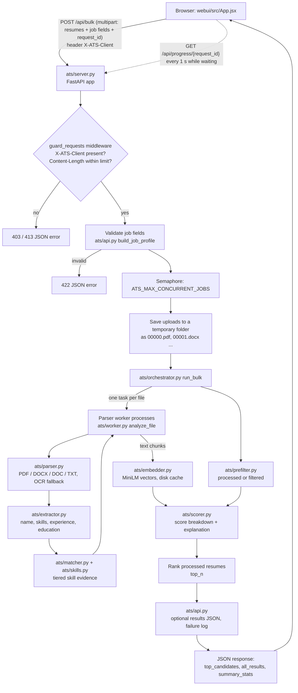
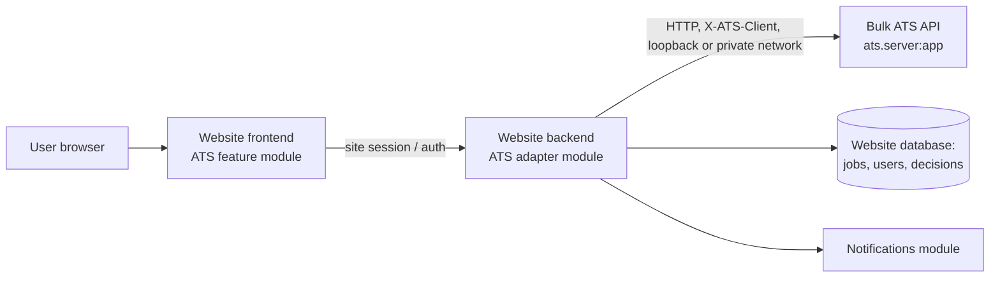

# Integrating Bulk ATS

This guide is for developers who need to run Bulk ATS, call it from another application, or embed
it in a larger website with other modules (authentication, user management, job management,
notifications, …). You do not need to know the project's history. Every route, setting and
behaviour described here comes from the current code (`ats/`, `webui/`, `tests/`). Where this guide
recommends something that is **not** implemented, it says so explicitly.

Contents

1. [Project overview](#1-project-overview)
2. [Architecture and module map](#2-architecture-and-module-map)
3. [Local development setup](#3-local-development-setup)
4. [API integration reference](#4-api-integration-reference)
5. [Integrating into a larger multi-feature website](#5-integrating-into-a-larger-multi-feature-website)
6. [Configuration, storage and privacy](#6-configuration-storage-and-privacy)
7. [Scoring and skill-matching semantics](#7-scoring-and-skill-matching-semantics)
8. [Integration contracts and extension points](#8-integration-contracts-and-extension-points)
9. [Integration roadmap](#9-integration-roadmap)
10. [Troubleshooting and handover checklist](#10-troubleshooting-and-handover-checklist)

---

## 1. Project overview

### What Bulk ATS does

Bulk ATS scores and ranks resumes against one job description. A caller sends a job (title,
description, required skills, preferred skills, minimum years of experience, minimum education)
and one or many resume files. For every file it returns exactly one outcome:

| Status | Meaning |
|---|---|
| `processed` | Parsed, scored and ranked (`rank` 1..n). |
| `filtered` | Parsed, but none of the job's required or preferred skills was found. Not ranked; the reason is in `explanation`. |
| `failed` | Could not be read (unsupported type, corrupt, empty, too large, …). The reason is in `error_message`. |

Each processed resume gets a score breakdown (skills, experience, semantic, education, final), the
matched and missing skills, per-skill evidence (`skill_evidence`) and a plain-text explanation.

### Core capabilities

- **File types:** `.pdf`, `.docx`, `.doc` (only if the `antiword` tool is installed), `.txt`.
  Anything else is reported as `failed` with `unsupported_file_type`; nothing is skipped silently.
- **PDF handling:** pdfminer text extraction (first `ATS_MAX_PDF_PAGES` = 12 pages); recovery of
  PDFs with a broken page tree; OCR fallback with Tesseract for scanned PDFs (first
  `ATS_OCR_MAX_PAGES` = 4 pages) when almost no text is found; DOCX files that only contain images
  are OCR'd too. PDFs whose text is drawn as vector outlines fail with `vector_text_pdf`.
- **Extraction (rule-based, no LLM):** candidate name, skills, years of experience, education level.
- **Skill matching:** deterministic, tiered evidence (exact, equivalent name, category member,
  related) driven by two data files, `ats/skill_taxonomy.json` and `ats/skill_relations.json`.
  See [section 7](#7-scoring-and-skill-matching-semantics).
- **Semantic score:** cosine similarity between the job text and the resume using the local
  `all-MiniLM-L6-v2` sentence-transformers model (CPU). It contributes 20 % of the final score and
  is never used to award skill credit.
- **Bulk throughput:** parsing runs in a pool of worker processes; embeddings run in the API
  process. Duplicate files (identical content) are flagged with `duplicate_of`.
- **Interfaces:** a FastAPI HTTP API (`ats/server.py`), a React UI (`webui/`), an interactive
  command line (`python -m ats.main`) and a folder benchmark script (`tools/benchmark.py`).

### What it does not do

- No authentication, user accounts, roles or multi-user/tenant isolation.
- No database. Nothing is stored per user; there is no "get previous results" endpoint.
- No job storage or job management. The job is sent with every request.
- No background job queue. `/api/bulk` is a synchronous request (see [4.3](#43-request-model-synchronous-with-optional-progress-polling)).
- No production deployment configuration (no Dockerfile, no reverse-proxy config, no TLS).
- No understanding of meaning: negation ("React was not part of my role") still counts as a mention.
- No hiring decision. Scores are a screening aid.

### Human review is required

Scores, filtering and rankings must be reviewed by a person before any decision about a
candidate. The matcher is keyword- and context-based, extraction is rule-based, and the prefilter
can exclude a relevant resume whose skills are written in words the taxonomy does not know. Show
reviewers the `skill_evidence` and `explanation` fields, and give them access to filtered and
failed files, not only the top of the ranking.

---

## 2. Architecture and module map

### Request flow



### Directory and file responsibilities

| Path | Responsibility |
|---|---|
| `ats/server.py` | FastAPI app: routes, `X-ATS-Client` guard, request-size guard, CORS, upload streaming to temporary files, concurrency semaphore. |
| `ats/api.py` | Python integration surface: `build_job_profile` (validation), `screen_files`, `screen_bulk`, `screen_single`; converts internal results to response objects (no text, no vectors); writes the optional results JSON and the failure log. |
| `ats/orchestrator.py` | Runs a bulk or single screening: worker pool, overlapping parsing and embedding, prefilter, scoring, ranking, duplicate detection, in-memory progress table. |
| `ats/worker.py` | `analyze_file`: everything for one file except the embedding (parse → extract → skill match → semantic chunks). Runs inside worker processes; each worker exits if the API process disappears (`watch_parent`). |
| `ats/parser.py` | Text extraction per file type, OCR fallback, failure codes (`ParseError`). |
| `ats/extractor.py` | Rule-based extraction of name, skills, experience years and education level. |
| `ats/skills.py` | Skill taxonomy index, tiered skill matching (`match_skills`), ambiguity/bullet/weak-evidence rules. |
| `ats/matcher.py` | Turns skill evidence into matched/missing lists, required credit and the preferred-skill bonus; cosine helper. |
| `ats/prefilter.py` | Decides `filtered` vs `processed`. |
| `ats/scorer.py` | Score components, weights, explanation text. |
| `ats/embedder.py` | MiniLM loading, chunking, embedding, on-disk vector cache. |
| `ats/config.py` | All settings and environment variables; creates the data folders. |
| `ats/resources.py` | Picks worker counts from CPU and free RAM. |
| `ats/schema.py` | Dataclasses: `JobProfile`, `ScoreBreakdown`, `ResumeResult` (internal), `ResumeResultResponse` (API), `ATSOutput`. |
| `ats/logger.py` | Console + daily log file (`<data dir>/logs/ats_YYYYMMDD.log`). |
| `ats/main.py` | Interactive command line (`python -m ats.main`). |
| `ats/skill_taxonomy.json` | Canonical skill names and their equivalent names (aliases). |
| `ats/skill_relations.json` | Category membership, related-skill groups, other-sense conflicts. |
| `ats/requirements.txt` | Python dependencies. |
| `webui/` | React 18 + Vite 5 single-page UI (`src/App.jsx`, `src/styles.css`, `vite.config.js`). |
| `tests/` | Automated tests (`unittest`), fixtures generated at runtime by `tests/helpers.py`. |
| `tools/benchmark.py` | Screen a local folder and print a summary. |
| `scripts/manual/` | Older ad-hoc scripts that call a running server. Not part of the test suite. |
| `sample_resumes/` | Three tiny synthetic text resumes. |
| `start_ats_stack.bat`, `start_ats_accurate_mode.bat`, `start_ats_fast_mode.bat` | Windows launchers for API + UI. |
| `README.md` | Feature, validation and benchmark notes. `TEST_MODES_GUIDE.md` explains the launchers; `ACCURACY_REPORT.md` is a historical report (older pipeline). |

Runtime data (not in Git) is written under `ATS_DATA_DIR` (default: the `ats/` folder):
`cache/embeddings/`, `logs/`, `output/`, `runs/`. See [section 6](#6-configuration-storage-and-privacy).

---

## 3. Local development setup

### Prerequisites

| Tool | Version verified for this handover | Notes |
|---|---|---|
| Python | 3.13.14 | `ats/requirements.txt` has lower bounds only; installed versions used for verification include fastapi 0.136.1, uvicorn 0.46.0, sentence-transformers 5.3.0, numpy 2.4.4. |
| Node.js / npm | 22.18.0 / 10.9.3 | For the React UI (Vite 5). |
| Tesseract OCR | optional | Needed only for scanned PDFs. Auto-detected in its default Windows install folder, or set `ATS_TESSERACT_CMD`. |
| antiword | optional | Needed only for legacy `.doc`. Git for Windows bundles it. Without it `.doc` files fail with `unsupported_file_type`. |

The project has been run and tested on **Windows 11** only. The Python code is not
Windows-specific, but the launchers are `.bat` files and no other OS has been verified.

The MiniLM model (about 90 MB) is downloaded by sentence-transformers on first use and cached
locally afterwards.

### Install

```bat
python -m venv .venv
.venv\Scripts\python -m pip install -r ats\requirements.txt
cd webui
npm install
```

### Start (Windows launcher)

```bat
start_ats_stack.bat            REM accurate mode: API on 127.0.0.1:8000, UI on 127.0.0.1:5173
start_ats_accurate_mode.bat    REM same as above
start_ats_fast_mode.bat        REM semantic scoring off for bulk runs (faster)
```

`start_ats_stack.bat` checks `.venv`, the Python packages and `npm`; stops any running
`uvicorn ats.server:app` / Vite UI; starts the API in its own window; waits for
`/api/health`; starts the UI in its own window; and opens the browser. Environment variables set
in the calling shell are inherited by both windows. To stop, close the two windows. On Windows a
`node` (Vite) process can survive its window; the launcher's clean-up step matches the `cmd`
wrapper but not that `node` process, so check for it before restarting (see troubleshooting).

### Start (manual, any shell)

```bat
REM API (from the repository root)
.venv\Scripts\python -m uvicorn ats.server:app --host 127.0.0.1 --port 8000

REM UI (from webui/)
npm run dev
```

`webui/vite.config.js` binds the dev server to `127.0.0.1:5173`. The UI calls the API at
`VITE_API_BASE` (default `http://127.0.0.1:8000`). `npm run build` produces a static build in
`webui/dist/` (not committed).

Other entry points: `python -m ats.main` (interactive command line) and
`python tools/benchmark.py <folder> [--top-n N]`.

### Environment variables

All are optional. Booleans accept `1/true/yes/on`; anything else is false.

| Variable | Default | Effect |
|---|---|---|
| `ATS_DATA_DIR` | `ats/` | Root for `cache/`, `logs/`, `output/`, `runs/`. Point it outside the repository for real data. |
| `ATS_SAVE_RESULTS` | `1` | Write a results JSON per bulk run to `output/`. Also controls whether the failure log contains file names. See [6](#6-configuration-storage-and-privacy). |
| `ATS_USE_SEMANTIC_BULK` | `1` | MiniLM semantic score in bulk runs. `0` = faster; weights are re-normalised without it. |
| `ATS_USE_SEMANTIC_SINGLE` | `1` | Same for `/api/single`. |
| `ATS_WARMUP_EMBEDDER` | value of `ATS_USE_SEMANTIC_BULK` | Load the model at API start. |
| `ATS_WARMUP_PARSE_POOL` | `1` | Start parser workers at API start. |
| `ATS_PREFILTER` | `1` | Report resumes with none of the job's skills as `filtered`. `0` = rank everything. |
| `ATS_OCR` | `1` | OCR fallback for scanned PDFs. |
| `ATS_OCR_MAX_PAGES` | `4` | Pages OCR'd per file. |
| `ATS_TESSERACT_CMD` | auto-detect | Path to `tesseract.exe`. |
| `ATS_MAX_PDF_PAGES` | `12` | PDF pages read per file. |
| `ATS_EMBEDDING_MAX_CHUNKS` | `3` | Text chunks (about 180 words each) embedded per resume. |
| `ATS_PARSE_WORKERS` (alias `ATS_PROCESS_WORKERS`) | from CPU and free RAM (max 16) | Parser processes. |
| `ATS_EMBEDDING_BATCH_SIZE` | `32` | Embedding batch size. |
| `ATS_EMBEDDING_THREADS` | auto (≤ 8) | torch threads for embeddings. |
| `ATS_MAX_FILES_PER_REQUEST` | `1000` | Files per `/api/bulk` request (413 above). |
| `ATS_MAX_FILE_SIZE_MB` | `20` | Per file. Bulk: the file is reported `failed` (`file_too_large`); single: 413. |
| `ATS_MAX_REQUEST_SIZE_MB` | `2048` | Checked against the `Content-Length` header of POST requests (413 above). |
| `ATS_MAX_CONCURRENT_JOBS` | `1` | Screening requests processed at the same time; others wait. |
| `ATS_ALLOWED_FOLDER_ROOTS` | empty (disabled) | Directories `/api/bulk-parallel-folder` may read, separated by `os.pathsep` (`;` on Windows). |
| `ATS_CORS_ORIGINS` | `http://localhost:5173,http://127.0.0.1:5173` | Comma-separated browser origins allowed to call the API. |
| `ATS_REFERENCE_DATE` | today | `YYYY-MM-DD`; what "present" means when computing experience. Use it when re-screening old resumes. |
| `VITE_API_BASE` (UI build/dev) | `http://127.0.0.1:8000` | API base URL used by the React UI. |

Fixed in code (not environment variables): score weights 0.40/0.30/0.20/0.10, category credit
0.75, weak-evidence credit 0, model `all-MiniLM-L6-v2` on CPU, default `top_n` 10
(`ats/config.py`).

### Tests

```bat
.venv\Scripts\python -m unittest discover -s tests -t .
```

At handover: **150 tests, all passing** (about 30–170 s depending on machine load). Tests generate
their own fixtures (PDF, scanned PDF, DOCX) and write runtime files to temporary folders. The
OCR tests need Tesseract; the `.doc` tests need antiword. `tests/test_workers.py` checks that
worker processes exit when the API process is killed.

Common test failures:

| Symptom | Likely cause |
|---|---|
| `ModuleNotFoundError` (fastapi, docx, sentence_transformers, …) | Dependencies not installed in the interpreter you are using; run with `.venv\Scripts\python`. |
| OCR tests fail | Tesseract not installed or not found; set `ATS_TESSERACT_CMD`. |
| `.doc` tests fail | antiword not on `PATH`. |
| First run very slow / network errors | MiniLM model being downloaded for the first time. |
| Timeouts in worker tests | Machine under heavy load; re-run. |

---

## 4. API integration reference

Base URL (local default): `http://127.0.0.1:8000`. All bodies are JSON responses; requests to
POST routes are `multipart/form-data`.

### 4.1 Routes

| Method | Path | Purpose |
|---|---|---|
| GET | `/api/health` | Liveness and capabilities. |
| POST | `/api/single` | Score one resume. |
| POST | `/api/bulk` | Score many resumes (up to `ATS_MAX_FILES_PER_REQUEST`). |
| GET | `/api/progress/{request_id}` | Progress of a running `/api/bulk` call that was given `request_id`. |
| POST | `/api/bulk-parallel-folder` | Score a folder on the API machine. Disabled unless `ATS_ALLOWED_FOLDER_ROOTS` is set. |

FastAPI also serves its default interactive docs at `/docs` and the schema at `/openapi.json`.
There is **no** route to fetch earlier results, list jobs, delete data or authenticate.

### 4.2 Headers and security behaviour

- **`X-ATS-Client: <any value>` is required on every POST.** Without it the API answers
  `403 {"detail": "Missing X-ATS-Client header."}`. This is not authentication: any client that
  can reach the port can send it. Its purpose is that a browser can only send a custom header
  cross-origin after a CORS preflight, which is only granted to `ATS_CORS_ORIGINS`, so other
  websites open in the user's browser cannot trigger screening runs.
- CORS: methods `GET`, `POST`; any request header; credentials not allowed.
- The API binds to `127.0.0.1` when started by the launcher or the command above.

### 4.3 Request model: synchronous, with optional progress polling

`/api/single` and `/api/bulk` are synchronous: the HTTP response arrives when screening is
finished. For bulk calls the client can generate its own `request_id` (any string; the first 64
characters are used), send it as a form field, and poll `GET /api/progress/{request_id}` while the
POST is still open. The UI polls once per second.

- Progress entries live in memory only (the newest ~200 are kept) and are lost on restart.
- A request waiting for the concurrency semaphore (`ATS_MAX_CONCURRENT_JOBS`, default 1) has
  no progress entry yet, so polling returns 404 until it starts. Treat 404 during a pending POST
  as "queued", not as an error.
- `stage` goes `analyzing` → `embedding` → `scoring` → `done`.

### 4.4 Job fields (all screening routes)

| Field | Type / format | Validation (422 with a readable `detail` if violated) |
|---|---|---|
| `title` | string | — |
| `description` | string | — |
| `required_skills` | comma-separated string | ≤ 100 required + preferred skills; each ≤ 80 characters |
| `preferred_skills` | comma-separated string | same; a skill listed in both counts as required |
| `min_experience_years` | number, default `0` | 0 to 50 |
| `required_education` | `any` (default), `diploma`, `associate`, `bachelor`, `master`, `phd` | must be one of these |

At least one of title, description, required or preferred skills must be non-empty. Skill names
are normalised to the taxonomy's canonical names (e.g. `k8s` → `kubernetes`); the response uses
canonical names.

### 4.5 `GET /api/health`

```json
{
  "status": "ok",
  "ocr_available": true,
  "doc_supported": true,
  "semantic_bulk": true,
  "prefilter": true,
  "max_files_per_request": 1000,
  "max_file_size_mb": 20,
  "folder_screening_enabled": false
}
```

### 4.6 `POST /api/single`

Form fields: `resume` (one file, required), the job fields, and `debug` (boolean, default false).
With `debug=true` the response includes `text_preview` (the first 500 characters of extracted
text) and the server prints a summary to its console. Leave `debug` off in integrations.

Example (synthetic data):

```bash
curl -s http://127.0.0.1:8000/api/single \
  -H "X-ATS-Client: hr-portal" \
  -F "resume=@asha_example.txt" \
  -F "title=Backend Engineer" \
  -F "description=Python backend developer building REST APIs with Docker." \
  -F "required_skills=python, sql, docker" \
  -F "preferred_skills=git, kubernetes" \
  -F "min_experience_years=3" \
  -F "required_education=bachelor"
```

Response (`200`, abridged: `extracted_skills`, `experience_years`, `education_level`, `file_path`,
`ocr_used`, `rank`, `duplicate_of` omitted here; the full field list is in [4.9](#49-result-object-resumeresultresponse)):

```json
{
  "candidate_id": "45091c4d-5ff7-4434-a74c-4ad779de59f4",
  "file_name": "asha_example.txt",
  "name": "Asha Example",
  "name_source": "header",
  "status": "processed",
  "scores": {"skills": 93.67, "experience": 100.0, "semantic": 69.95, "education": 100.0, "final": 91.46},
  "matched_skills": ["python", "sql", "docker"],
  "matched_preferred_skills": ["git"],
  "missing_skills": [],
  "skill_evidence": [
    {"skill": "python", "kind": "required", "tier": "exact", "evidence": "python", "credit": 1.0, "strength": "explicit"},
    {"skill": "sql", "kind": "required", "tier": "category", "evidence": "postgresql", "credit": 0.75, "strength": "explicit"},
    {"skill": "docker", "kind": "required", "tier": "exact", "evidence": "docker", "credit": 1.0, "strength": "explicit"},
    {"skill": "git", "kind": "preferred", "tier": "exact", "evidence": "git", "credit": 1.0, "strength": "explicit"}
  ],
  "explanation": "Candidate Evaluation\nCandidate : Asha Example\nRole      : Backend Engineer\nScore     : 91.46%\n\nStrengths:\n- Matched 3/3 required skills: python, sql (via postgresql: specific tool for this skill, 75% credit), docker\n- 5.9 years experience (required: 3+)\n- Semantic alignment with JD: 0.70\n- Matched preferred skills: git\n\nGaps:\n- No critical gaps identified\n\nRecommendation: Strong shortlist. Schedule technical round.",
  "error_message": null,
  "text_preview": null,
  "stage_timings": {"parse": 0.0008, "extract": 0.0088, "embed": 0.0704, "score": 0.0001}
}
```

The single route never filters: `/api/single` returns `processed` or `failed`. A file over the size
limit returns `413`; a missing file name returns `400`.

### 4.7 `POST /api/bulk`

Form fields: `resumes` (repeat once per file, required), the job fields, `top_n` (1–100000,
default 10) and optional `request_id`.

```bash
curl -s http://127.0.0.1:8000/api/bulk \
  -H "X-ATS-Client: hr-portal" \
  -F "resumes=@asha_example.txt" -F "resumes=@ben_sample.txt" \
  -F "resumes=@scan.png" -F "resumes=@broken.pdf" \
  -F "title=Backend Engineer" \
  -F "description=Python backend developer building REST APIs with Docker." \
  -F "required_skills=python, sql, docker" -F "preferred_skills=git, kubernetes" \
  -F "min_experience_years=3" -F "required_education=bachelor" \
  -F "top_n=5" -F "request_id=8f1c2b7e-0000-4000-8000-000000000001"
```

Response (`200`, abridged; synthetic data):

```json
{
  "job_id": "6629a1c9-6645-4b29-914d-78cfe67e1447",
  "total_submitted": 4,
  "total_processed": 1,
  "total_filtered": 1,
  "total_failed": 2,
  "time_taken_seconds": 0.17,
  "throughput_per_second": 23.17,
  "top_candidates": [
    {"rank": 1, "candidate_id": "e537b6a3-…", "file_name": "asha_example.txt", "name": "Asha Example",
     "status": "processed", "scores": {"skills": 93.67, "experience": 100.0, "semantic": 69.95, "education": 100.0, "final": 91.46},
     "matched_skills": ["python", "sql", "docker"], "missing_skills": [], "skill_evidence": ["… as in 4.6 …"]}
  ],
  "all_results": [
    {"status": "processed", "file_name": "asha_example.txt", "rank": 1, "…": "…"},
    {"status": "filtered", "file_name": "ben_sample.txt", "rank": null,
     "scores": {"skills": 0.0, "experience": 0.0, "semantic": 0.0, "education": 0.0, "final": 0.0},
     "explanation": "Filtered: none of the job's required or preferred skills were found in the resume. Weak evidence, not counted: github for git (web or profile link)",
     "skill_evidence": [{"skill": "git", "kind": "preferred", "tier": "category", "evidence": "github", "credit": 0.0, "strength": "weak", "note": "web or profile link"}]},
    {"status": "failed", "file_name": "scan.png", "rank": null, "error_message": "unsupported_file_type: '.png' is not supported"},
    {"status": "failed", "file_name": "broken.pdf", "rank": null, "error_message": "corrupt_file: unreadable PDF (no pages could be located)"}
  ],
  "summary_stats": {
    "avg_score": 91.46, "top_score": 91.46,
    "score_distribution": {"80-100": 1, "60-80": 0, "40-60": 0, "0-40": 0},
    "most_common_missing_skill": "none", "most_common_missing_skill_count": 0,
    "cache_hits": 0, "cache_hit_rate": 0.0,
    "semantic_enabled": true, "prefilter_enabled": true,
    "failure_reasons": {"unsupported_file_type": 1, "corrupt_file": 1},
    "ocr_used": 0, "duplicate_files": 0, "warnings": [],
    "resources": "cpu=32 free_ram=2.3GB parse_workers=11 embed_batch=32 embed_threads=8",
    "results_path": "<absolute path on the API machine, or null>",
    "failed_log_path": "<absolute path on the API machine, or null>"
  },
  "execution_summary": {
    "duration_seconds": 0.17, "total_submitted": 4, "total_processed": 1, "total_filtered": 1,
    "total_failed": 2, "throughput_resumes_per_second": 23.17, "semantic_enabled": true
  }
}
```

Contract:

- `total_submitted == total_processed + total_filtered + total_failed == len(all_results)`.
  Every uploaded file appears exactly once in `all_results`.
- `top_candidates` = the first `top_n` processed results, ordered by final score, then skills
  score, then experience score, then file name.
- `rank` is set for processed results only (`null` for filtered and failed).
- Filtered and failed results have all scores `0.0`. Filtered results still carry extracted
  name, skills, experience, education and `skill_evidence` (related or weak evidence, if any).
- Files uploaded twice with the same name are labelled `name [2]`, `name [3]`, …;
  identical content is flagged with `duplicate_of` (the first file's name).
- `results_path` / `failed_log_path` are server file paths. Do not show them to end users.
- Starlette rejects multipart requests with more than 1000 files. The bundled UI therefore sends
  at most 900 files per request and merges the batches client-side (see [5.5](#55-displaying-results)).

### 4.8 `GET /api/progress/{request_id}`

```json
{"total": 4, "analyzed": 4, "embedded": 1, "stage": "done",
 "started_at": 1791741797.41, "updated_at": 1791741797.58}
```

`404 {"detail": "Unknown request id"}` if the id is unknown, evicted or not started yet.

### 4.9 Result object (`ResumeResultResponse`)

| Field | Type | Notes |
|---|---|---|
| `candidate_id` | string (UUID4) | Random per run; not stable across runs. |
| `file_path` | string | Display path: the upload's file name (folder mode: path relative to the folder). |
| `file_name` | string | File name. |
| `name` | string | Extracted candidate name. May be wrong. |
| `name_source` | string | Where the name came from: `header`, `label`, `email` or `filename` (fallback). |
| `extracted_skills` | string[] | Taxonomy skills found anywhere in the resume. |
| `experience_years` | number | Rule-based estimate. |
| `education_level` | string | `unknown`, `diploma`, `associate`, `bachelor`, `master`, `phd`. |
| `scores` | object | `skills`, `experience`, `semantic`, `education`, `final` (0–100). |
| `matched_skills` / `missing_skills` | string[] | Required skills with / without creditable evidence. |
| `matched_preferred_skills` | string[] | Preferred skills with creditable evidence. |
| `skill_evidence` | object[] | See [7.2](#72-skill-evidence-tiers). |
| `explanation` | string | Human-readable summary (multi-line). Empty for failed files. |
| `status` | string | `processed`, `filtered`, `failed`. |
| `error_message` | string \| null | `<code>: <detail>` for failed files. |
| `stage_timings` | object | Seconds per stage (`parse`, `extract`, `embed`, `score`). |
| `ocr_used` | boolean | OCR was needed. |
| `rank` | integer \| null | Rank among processed files. |
| `duplicate_of` | string \| null | Display name of the first identical file. |
| `text_preview` | string \| null | Only `/api/single` with `debug=true`. |

Failure codes (prefix of `error_message`): `unsupported_file_type`, `empty_file`, `corrupt_file`,
`encrypted_pdf`, `no_text_layer`, `vector_text_pdf`, `empty_text`, `file_too_large`,
`parse_timeout` (antiword), `parse_error`, `internal_error`.

### 4.10 `POST /api/bulk-parallel-folder`

Form fields: `folder_path` plus the bulk fields. Returns the same body as `/api/bulk`.
`403` when `ATS_ALLOWED_FOLDER_ROOTS` is empty (default) or the folder is outside the allowed
roots; `400` if the folder does not exist or is empty. In this mode file names (relative paths)
appear in logs. Intended for local batch work, not for a shared website.

### 4.11 Status codes

| Code | When |
|---|---|
| 200 | Success. Individual files may still be `failed` inside a 200 bulk response. |
| 400 | `/api/single` without a file name; folder not found / empty. |
| 403 | Missing `X-ATS-Client` on a POST; folder screening disabled or folder not allowed. |
| 404 | Unknown progress id. |
| 413 | Too many files; `Content-Length` above `ATS_MAX_REQUEST_SIZE_MB`; single file above `ATS_MAX_FILE_SIZE_MB`. |
| 422 | Job/field validation (string `detail`) or a missing required form field such as `resumes` (FastAPI list-style `detail`). |

Verified error bodies:

```json
{"detail": "Missing X-ATS-Client header."}
{"detail": "min_experience_years must be between 0 and 50."}
{"detail": "required_education must be one of: any, diploma, associate, bachelor, master, phd."}
{"detail": "The job needs at least a title, a description or some skills."}
{"detail": [{"type": "missing", "loc": ["body", "resumes"], "msg": "Field required", "input": null}]}
{"detail": "Folder screening is disabled. Set ATS_ALLOWED_FOLDER_ROOTS to the directories that may be screened."}
```

### 4.12 Python (in-process) API

`ats/api.py` exposes `build_job_profile`, `screen_files`, `screen_bulk`, `screen_single`
(async functions returning the same objects as the HTTP API). Use them for scripts and tests.
A larger website should call the HTTP API instead (see [5.1](#51-recommended-boundary)) so that the
ATS's worker processes, model and dependencies stay in their own process.

---

## 5. Integrating into a larger multi-feature website

**Current implementation:** a local, single-user service with no authentication, no persistence
and no job management. **Everything in this section that goes beyond calling the existing routes
is a recommendation** and is marked as such.

### 5.1 Recommended boundary

Treat Bulk ATS as a separate **screening service** behind its HTTP API:



- The **website backend** owns users, authentication, authorisation, jobs, audit and storage.
- An **ATS adapter module** in the website backend is the only code that talks to Bulk ATS.
  It builds the form request, adds `X-ATS-Client`, maps the response to the website's own types and
  decides what to store.
- Bulk ATS stays stateless from the website's point of view: send job + files, receive results.
- Keep Bulk ATS bound to `127.0.0.1` (same host) or a private network that only the website
  backend can reach. Do **not** expose it directly to browsers on the public internet — it has no
  authentication.

Using the bundled React UI directly from browsers (as today) is fine for local, single-user use.

### 5.2 Frontend-to-backend communication (recommended)

1. The website frontend uploads files and the job (or a job id) to **the website backend**,
   authenticated with the website's normal session.
2. The website backend checks that the user may screen for that job, then forwards a multipart
   request to `POST /api/bulk` with the job fields and `X-ATS-Client: <website-backend-name>`.
3. For progress, the website backend generates the `request_id`, returns it to the frontend, and
   exposes its own progress route that proxies `GET /api/progress/{request_id}`.
4. When the bulk call returns, the backend stores what the website needs (see [6.5](#65-recommendations-for-real-resumes-and-pii))
   and returns a mapped result to the frontend.

If the frontend must call Bulk ATS directly (only for same-machine/internal tools), add the
frontend origin to `ATS_CORS_ORIGINS` and send `X-ATS-Client` from the browser.

### 5.3 API client wrapper pattern (recommended)

Keep one small client in the website backend. Example in TypeScript (adapt to your backend
language); it only uses the routes and fields documented above:

```ts
// ats-client.ts — the only module that knows Bulk ATS's HTTP contract.
export interface AtsJob {
  title: string;
  description: string;
  requiredSkills: string[];
  preferredSkills: string[];
  minExperienceYears: number;
  requiredEducation: "any" | "diploma" | "associate" | "bachelor" | "master" | "phd";
}

// ATS_BASE_URL is a setting of *your website backend*, not of Bulk ATS.
const ATS_BASE = process.env.ATS_BASE_URL ?? "http://127.0.0.1:8000";
const HEADERS = { "X-ATS-Client": "website-backend" };

function jobForm(job: AtsJob): FormData {
  const fd = new FormData();
  fd.append("title", job.title);
  fd.append("description", job.description);
  fd.append("required_skills", job.requiredSkills.join(","));
  fd.append("preferred_skills", job.preferredSkills.join(","));
  fd.append("min_experience_years", String(job.minExperienceYears));
  fd.append("required_education", job.requiredEducation);
  return fd;
}

export async function screenBulk(job: AtsJob, files: { name: string; data: Blob }[],
                                 topN: number, requestId: string) {
  if (files.length > 900) throw new Error("Split into batches of at most 900 files");
  const fd = jobForm(job);
  fd.append("top_n", String(topN));
  fd.append("request_id", requestId);
  for (const f of files) fd.append("resumes", f.data, f.name);
  const res = await fetch(`${ATS_BASE}/api/bulk`, { method: "POST", body: fd, headers: HEADERS });
  if (!res.ok) throw new AtsError(res.status, await res.text());
  return res.json(); // map to your own types here; do not leak ATS internals further
}

export async function progress(requestId: string) {
  const res = await fetch(`${ATS_BASE}/api/progress/${encodeURIComponent(requestId)}`);
  return res.status === 404 ? { stage: "queued" } : res.json();
}

export class AtsError extends Error {
  constructor(public status: number, public body: string) { super(`ATS ${status}: ${body}`); }
}
```

Set a generous HTTP timeout: a bulk request lasts as long as the screening (hundreds of resumes
can take minutes, see README "Benchmarks").

### 5.4 Isolating ATS from other modules

- **Authentication / user management:** Bulk ATS has none and must not be given website
  credentials or user tokens. Authorise in the website backend before calling it.
- **Job management:** keep jobs in the website's own store. Send the job's fields with every
  call; Bulk ATS's `job_id` is generated per request and is not a stable identifier.
- **Candidates:** `candidate_id` is random per run. Link results to your own candidate/application
  ids by keeping your own mapping from uploaded file to application, e.g. by giving each upload a
  unique, non-identifying file name (`<application-id>.pdf`) that you can map back from `file_name`.
- **Notifications:** trigger them from the website backend after the bulk call returns; Bulk ATS
  sends nothing.
- **Routing:** mount the ATS feature under its own prefix in the website (e.g. `/ats/...` in your
  backend). Bulk ATS's own `/api/...` paths stay internal to the adapter.
- **No shared imports:** other website modules must not import `ats.*` Python modules or read
  `ats/skill_*.json` directly. Go through the adapter and the HTTP API. Changes inside Bulk ATS then
  cannot break other modules as long as the HTTP contract in section 4 holds.

### 5.5 Displaying results

Recommended UI elements (the bundled UI shows the first four; it shows only the *count* of
filtered resumes):

- Ranked table from `top_candidates`: `rank`, `name`, `file_name`, `scores.final` and the four
  components, `matched_skills`, `duplicate_of`.
- Per candidate: `explanation` (pre-formatted multi-line text) and a `skill_evidence` table with
  skill, kind, tier, evidence, credit and, for weak evidence, `note`.
- Failures: `all_results` where `status == "failed"` → `file_name` and `error_message`;
  `summary_stats.failure_reasons` for counts.
- Filtered resumes: `all_results` where `status == "filtered"` → `file_name` and `explanation`.
  Reviewers should be able to open these; the prefilter can be wrong.
- Totals: `total_submitted`, `total_processed`, `total_filtered`, `total_failed`, and
  `summary_stats.semantic_enabled` (scores are not comparable between runs with and without
  semantic scoring).
- Batches: if you split files into several requests (≤ 900 each), merge `top_candidates` from all
  batches, sort by `final`, then `skills`, then `experience`, then file name (as
  `webui/src/App.jsx` does), and re-number ranks. Each batch returns its own top N, so the
  union contains the global top N. `duplicate_of` only detects duplicates within one request.

### 5.6 Suggested integration steps (separate frontend and backend)

1. Run Bulk ATS locally and pass the handover checklist ([section 10](#10-troubleshooting-and-handover-checklist)).
2. Add the ATS adapter module to the website backend (5.3) with contract tests against a
   running Bulk ATS using synthetic resumes.
3. Add website routes for "screen applications for job X" and "progress", protected by the
   website's auth.
4. Add the frontend feature module that calls only the website routes.
5. Decide and implement storage/retention for results in the website ([6.5](#65-recommendations-for-real-resumes-and-pii)).
6. Run Bulk ATS with `ATS_DATA_DIR` outside the repository and, unless results must be kept by
   the ATS itself, `ATS_SAVE_RESULTS=0`.

---

## 6. Configuration, storage and privacy

### 6.1 What is stored, where

All paths are under `ATS_DATA_DIR` (default `ats/`).

| Location | Content | Written when |
|---|---|---|
| `output/results_<job_id>_<timestamp>.json` | Full bulk result: job, every result's file name, extracted name, skills, experience, education, scores, evidence, explanation, error message. **No resume text, no vectors** (`text_preview` is always null). | Every bulk run when `ATS_SAVE_RESULTS=1` (default). |
| `runs/failed_files_<timestamp>_<job>.jsonl` | One line per failed file. With `ATS_SAVE_RESULTS=1`: `file_path` (file name), `error_message`, `stage_timings`. With `ATS_SAVE_RESULTS=0`: `candidate_id` (random UUID, also in the API response), `file_type` (e.g. `.pdf`), `error_message` (any occurrence of the file name replaced by `<file>`), `stage_timings` — **no file name**. | Bulk runs with at least one failed file. |
| `logs/ats_YYYYMMDD.log` | Start-up settings, run counts, parse failures. Uploads are referred to by their temporary index name (`00005.pdf`), not the original name. Folder mode and the command-line tools log real file names. | Always. |
| `cache/embeddings/<hash>.npy` | One 384-number MiniLM vector per resume. No text. The file name is a SHA-256-based hash of the model, version and resume text, so someone holding a resume could check whether it was screened. Not controlled by `ATS_SAVE_RESULTS`. | When semantic scoring runs. |
| System temp `ats_bulk_api_*` / `ats_single_api_*` | Uploaded files under generated names (`00000.pdf`, `resume.pdf`). | During a request; deleted when the request finishes. |
| Memory | Progress entries (counts only); parsed text and vectors during a request. | Until restart / end of request. |

The server console additionally shows log lines and, for `/api/single` with `debug=true`, a summary
including the extracted name and skills.

### 6.2 `ATS_SAVE_RESULTS`

- `1` (default): a results JSON is written per bulk run (contains candidate names and file names);
  the failure log contains file names.
- `0`: no results JSON is written; the failure log contains no file names (verified by
  `tests/test_api.py::FailureLogPrivacyTests` and a live run). What can still be persisted with `0`:
  the failure log (random id, file type, reason, timings), the daily log (counts, index names,
  reasons), and the embedding cache (vectors only).

### 6.3 Filename handling

Client file names are reduced to a base name (path components and control characters removed,
max 200 characters) and used only as display names in responses. Uploaded bytes are saved under
generated names, so client file names never reach the file system.

### 6.4 Protections: implemented vs not implemented

| Implemented | Not implemented |
|---|---|
| Loopback binding (launcher, documented commands, Vite config); test `tests/test_local_binding.py` | Authentication, authorisation, user/tenant isolation |
| `X-ATS-Client` header on POSTs + CORS allow-list (blocks cross-site browser requests) | TLS / HTTPS |
| File count, file size and request size limits; one screening job at a time by default | Rate limiting per client |
| No resume text or vectors in responses (except `/api/single` `debug=true`) or saved results | Encryption at rest |
| Folder screening disabled by default and restricted to allowed roots | Automatic retention / deletion of `output/`, `runs/`, `logs/`, `cache/` |
| Name-free failure log when `ATS_SAVE_RESULTS=0` | Audit log of who screened what |
| Worker processes exit if the API process dies | Malware scanning of uploads |

### 6.5 Recommendations for real resumes and PII

- Set `ATS_DATA_DIR` to a folder outside the source tree with restricted access; never commit it.
- Use `ATS_SAVE_RESULTS=0` when the website stores results itself.
- Agree a retention period and delete `output/`, `runs/`, `logs/` and `cache/embeddings/` contents
  accordingly (there is no automatic cleanup).
- Store in the website only what reviewers need (scores, evidence, explanation, status) linked to
  your own application ids; avoid copying extracted names and file names into other systems.
- Use synthetic resumes for demos, tests, screenshots and bug reports.
- Keep Bulk ATS unreachable from the internet until authentication exists in front of it.

---

## 7. Scoring and skill-matching semantics

### 7.1 Score components and weights (`ats/scorer.py`, `ats/config.py`)

| Component | Weight | How it is computed (0–100) |
|---|---|---|
| Skills | 0.40 | (sum of credits of required skills ÷ number of required skills) × 100 + preferred bonus, capped at 100. Preferred bonus = 2 points × sum of preferred credits, max 10. No required skills → 100. |
| Experience | 0.30 | years ÷ `min_experience_years` × 100 (capped); 100 if the minimum is 0. Set to 0 if the job lists skills and none was found (years in an unrelated field do not count). |
| Semantic | 0.20 | cosine(job text, resume) × 100. If semantic scoring is off or unavailable, its weight is removed and the others are re-normalised. |
| Education | 0.10 | 100 if the requirement is met (or `any`), 70 if one level short, 40 if lower, 0 if no education found. |

`final = Σ weight × component ÷ Σ weights used`. Unrelated documents still get semantic scores
around 5–25, so compare semantic values within one run, not as absolutes.

### 7.2 Skill evidence tiers

Each job skill gets at most one evidence item (the best found). `skill_evidence` items:
`{skill, kind: required|preferred, tier, evidence, credit, strength: explicit|weak, note?}`.

| Tier | Example | Credit |
|---|---|---|
| `exact` | "Python" for `python` | 1.0 |
| `alias` | "k8s" for `kubernetes`; "HR" for `human resources` | 1.0 |
| `category` | "PostgreSQL" for `sql` (a specific member of a broad skill) | 0.75 |
| `related` | "Kotlin" for `java` | 0 (shown to the reviewer only) |

**Weak evidence** (`strength: "weak"`, credit 0, with `note`): a mention only inside a web/profile
link (`github.com/...`), a bare label on a contact line, or part of an organisation name
("Income Tax Department", "… Pvt Ltd"). An explicit mention elsewhere in the resume always wins.

A skill is **matched** when its evidence tier is not `related` and credit > 0.

Context rules that avoid false positives (in `ats/skills.py`):
- Ambiguous short names (e.g. "R", "C", "Go", "React", "Angular") count only in a skills list or
  next to other recognised skills / confirming words.
- A lone letter from a PDF bullet glyph ("• HR" extracted as "e hr") cannot form an acronym
  (not EHR), but the word after the bullet still counts as a list item (HR).
- Names with another meaning nearby are ignored (`conflicts` in `skill_relations.json`, e.g.
  "EMR" next to AWS terms is Amazon EMR, not medical records).

### 7.3 Prefilter

With `ATS_PREFILTER=1` (default), a resume is `filtered` if the job lists skills and none of the
required **or** preferred skills is matched. The prefilter uses the same evidence as the score, so
related or weak evidence alone does not pass it; the explanation then names that evidence.
Set `ATS_PREFILTER=0` to rank every readable resume.

### 7.4 Interpreting explanation fields

- `explanation` (processed): strengths (matched required skills with their tier, experience vs
  requirement, semantic alignment, preferred skills), gaps (missing skills, short experience,
  education), and a recommendation line from the final score: ≥ 80 "Strong shortlist. Schedule
  technical round.", ≥ 60 "Borderline profile. Manual review recommended.", otherwise "Below
  threshold. Unlikely fit for current role." The wording is the same for every job type.
- `explanation` (filtered): the filter reason plus any related/weak evidence that was not counted.
- `skill_evidence`: the authoritative per-skill record; `evidence` is the term found in the resume.

### 7.5 Known limitations

- False positives: negation is not understood; developers who *built* HR/payroll software get HR
  category credit; "sales person" in a software project counts as sales.
- False negatives: skill names split across a line break; ambiguous names in a vertical list with no
  other skill nearby; versioned or described names ("Tally 7.2"); any skill or synonym not in the
  data files (matched literally only).
- When one job skill contains another ("manufacturing" and "lean manufacturing"), the longer one
  takes the mention.
- Extraction is rule-based: unusual layouts and two-column PDFs can hide or misplace experience
  dates and degrees; extracted names can be wrong (a heading phrase or the file name).
- Only the first 12 PDF pages and 4 OCR pages are read; OCR quality depends on the scan.
- "Present" means today unless `ATS_REFERENCE_DATE` is set.

### 7.6 Why human review is needed

Because of the limitations above, a good candidate can be filtered or ranked low, and a weak one
ranked high. Reviewers should check `skill_evidence` for borderline candidates, look at filtered
and failed files, and make all decisions themselves.

---

## 8. Integration contracts and extension points

### 8.1 Adding a skill or relationship

- **New skill or equivalent name** → `ats/skill_taxonomy.json`: `"canonical name": ["alias", ...]`.
  Canonical names are lowercase. Aliases are equivalent names (credit 1.0). Comparison ignores
  case and separators (space . - _ /).
- **Broad skill with specific members** → `categories` in `ats/skill_relations.json`:
  `"sql": ["mysql", "postgresql", ...]`. Direction matters: members are evidence for the broad
  skill (credit 0.75), never the reverse.
- **Related but not interchangeable** → a group in `related`: `["java", "kotlin", "scala"]` (no credit).
- **Other sense of a name** → `conflicts`: `"emr": ["aws", "amazon", ...]`.
- Names in `skill_relations.json` are resolved through the taxonomy, so every name there must exist
  in `skill_taxonomy.json` (a test checks this).
- Do not put relationships into aliases: an alias earns full credit.

After any data change, run the full test suite and add a test in `tests/test_skill_matching.py`
showing the new match and at least one text that must **not** match.

### 8.2 Extending parsers, scoring or the API safely

- **Parsers:** add a function to `EXT_ROUTER` in `ats/parser.py`; raise `ParseError("<code>", "<detail>")`
  for expected failures (never let exceptions escape — `parse_document` and `analyze_file` convert
  them to `failed` results). Bump `PARSER_VERSION` in `ats/config.py`. Keep worker modules free of
  heavy imports (no torch in `ats/worker.py`'s import chain).
- **Scoring:** weights and credits live in `ats/config.py`; formulas in `ats/scorer.py`. Changing
  them changes every ranking — treat it as a product decision, re-run the tests and compare rankings
  on a fixed synthetic or approved dataset before and after.
- **API:** keep existing fields and status codes stable; add new fields instead of renaming. New
  POST routes automatically get the `X-ATS-Client` guard (middleware). Never add resume text to
  responses or saved files.

### 8.3 Input/output contract summary

- Input: multipart form, `X-ATS-Client` header, job fields as in [4.4](#44-job-fields-all-screening-routes).
- Output: one result per file, statuses `processed | filtered | failed`, counts that add up,
  scores 0–100, canonical skill names, no resume text.
- Errors: request-level errors are HTTP 4xx with `{"detail": ...}`; file-level errors are `failed`
  results inside a 200 response.

### 8.4 Regression-test requirements for new features

- Every bug fix and feature adds a test under `tests/`; do not loosen existing assertions.
- Skill-matching changes: positive and negative examples.
- Parser changes: generate fixtures in tests (see `tests/helpers.py`); never commit real resumes.
- API changes: tests in `tests/test_api.py`, including the status codes and that no resume text
  is returned.
- Privacy-relevant changes: assert what is (not) written under `ATS_DATA_DIR`.
- Run `.venv\Scripts\python -m unittest discover -s tests -t .` before every merge.

### 8.5 Not breaking other modules

- Version the HTTP contract in your adapter; add contract tests in the website that run against a
  real Bulk ATS with synthetic files.
- Keep ATS configuration in environment variables owned by the ATS deployment, not in other modules.
- Do not share the ATS's Python environment with other services (torch and pdfminer are heavy).

---

## 9. Integration roadmap

These phases are **recommendations**. Only Phase A is supported by the current code without changes.

### Phase A — isolated local integration

- Prerequisites: Python 3.13, Node 22, optional Tesseract/antiword; repository cloned.
- Deliverables: Bulk ATS running locally via the launcher; team familiar with the API and UI.
- Acceptance: 150 tests pass; `/api/health` OK; a synthetic bulk run returns
  `submitted = processed + filtered + failed`; API and UI listen only on 127.0.0.1.

### Phase B — shared website integration with an API boundary

- Prerequisites: Phase A; website backend can reach Bulk ATS on loopback or a private network.
- Deliverables: ATS adapter module (5.3) in the website backend; website routes for screening and
  progress behind the website's auth; frontend feature module showing rankings, evidence, filtered
  and failed files; `ATS_DATA_DIR` outside the repo; `ATS_SAVE_RESULTS=0` if the website stores
  results.
- Acceptance: contract tests pass against a running Bulk ATS; no other module imports `ats.*`;
  Bulk ATS is not reachable from browsers directly; reviewers can see evidence and filtered files.

### Phase C — authentication, authorisation, user isolation, controlled persistence (if required)

- Prerequisites: Phase B; decisions on who may screen which jobs and on retention.
- Deliverables (new work, not implemented today): authentication in front of Bulk ATS (or keep it
  private behind the website backend); per-user/per-job authorisation in the website; storage of
  results in the website database with retention; audit log of screening runs.
- Acceptance: unauthenticated requests cannot reach screening; users only see their jobs' results;
  retention deletes old data automatically; tests cover access rules.

### Phase D — deployment, observability, retention and production hardening

- Prerequisites: Phase C.
- Deliverables (new work): a deployment package (e.g. container) with pinned dependency versions;
  TLS at the edge; resource sizing for parser workers and the model; request timeouts and queueing
  appropriate to bulk sizes; health checks; log shipping without candidate data; scheduled cleanup
  of `ATS_DATA_DIR`; backup policy for website data; load test with synthetic resumes.
- Acceptance: documented deployment; monitoring alerts on failures and latency; retention verified;
  load test meets agreed throughput; security review passed.

---

## 10. Troubleshooting and handover checklist

### Troubleshooting

| Problem | Check / fix |
|---|---|
| Launcher says the virtual environment or packages are missing | Create `.venv` and install `ats\requirements.txt` (section 3). |
| Launcher: "npm is not available" | Install Node.js and reopen the terminal. |
| Backend did not become healthy | Look at the "ATS API" window; first start downloads the MiniLM model; port 8000 may be in use. |
| UI loads but requests fail with CORS errors | The UI origin must be in `ATS_CORS_ORIGINS`; `VITE_API_BASE` must point to the API. |
| 403 "Missing X-ATS-Client header." | Add the header to every POST. |
| 413 | Too many files (split into ≤ 900 per request), or a file/request over the size limits. |
| 422 | Read `detail`; job fields are validated (section 4.4). |
| Progress returns 404 | Request not started yet (queued behind another job), wrong id, or the server restarted. |
| `.doc` files fail with `unsupported_file_type` | Install antiword (`/api/health` → `doc_supported`). |
| Scanned PDFs fail with `no_text_layer` | Install Tesseract or set `ATS_TESSERACT_CMD` (`/api/health` → `ocr_available`). |
| `vector_text_pdf` | The PDF has no text layer and no images; ask for a normal PDF or DOCX. |
| `encrypted_pdf` | Password-protected PDF; ask for an unprotected copy. |
| Bulk run slow | Semantic scoring is the main extra cost; try `start_ats_fast_mode.bat` or `ATS_USE_SEMANTIC_BULK=0`; check free RAM (worker count depends on it) and `ATS_PARSE_WORKERS`. |
| Workers left running | Parser worker processes exit within a few seconds after the API process dies. |
| UI starts on port 5174 (or another port) and requests fail with CORS errors | An old `node` (Vite) process still holds 5173 (it can outlive its window, and the launcher's clean-up does not match it). Stop it, e.g. PowerShell: `Get-CimInstance Win32_Process -Filter "name='node.exe'" \| ? CommandLine -like '*vite*' \| % { Stop-Process -Id $_.ProcessId }`, then restart. |
| A relevant resume was filtered | Its skills may be written in words the taxonomy does not know; add aliases/relations (section 8.1) or run with `ATS_PREFILTER=0`. |
| Wrong candidate name | Name extraction is heuristic; rely on the file/application mapping, not the name. |

### Handover checklist

- [ ] `.venv` created and `pip install -r ats\requirements.txt` succeeded.
- [ ] `npm install` in `webui/` succeeded; `npm run build` succeeds.
- [ ] `.venv\Scripts\python -m unittest discover -s tests -t .` → 150 tests OK.
- [ ] `start_ats_stack.bat` starts API and UI; `GET http://127.0.0.1:8000/api/health` returns `"status": "ok"`.
- [ ] `netstat -ano | findstr LISTENING` shows ports 8000 and 5173 on `127.0.0.1` only.
- [ ] A bulk run with synthetic PDF, DOCX and an unsupported file shows ranked, filtered and failed
      rows, and `total_submitted = processed + filtered + failed`.
- [ ] A POST without `X-ATS-Client` returns 403.
- [ ] `ATS_DATA_DIR` points outside the repository for any real data; `ATS_SAVE_RESULTS` chosen deliberately.
- [ ] After a run with `ATS_SAVE_RESULTS=0`, `output/` has no new file and `runs/` contains no file names.
- [ ] The website adapter is the only module calling Bulk ATS; Bulk ATS is not reachable from the internet.
- [ ] Reviewers can see `skill_evidence`, explanations, filtered and failed files.
- [ ] No real resumes, results, logs or caches are committed (`git status` clean of `ats/output`, `ats/runs`, `ats/logs`, `ats/cache`).
